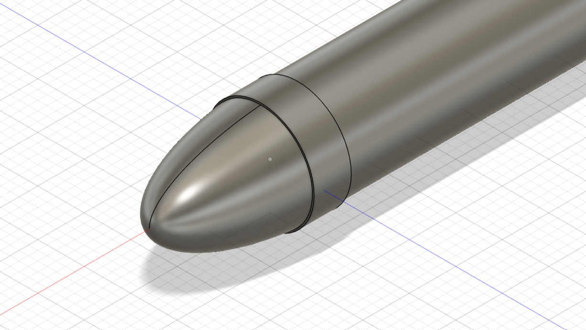
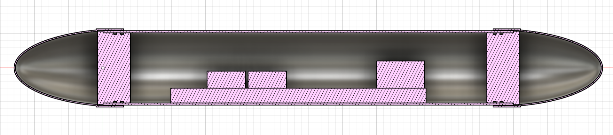

# Engineering log - 2026-11-24

## Step 8: electronics and bill of materials
Chose ESP32 + RS485 tether + DRV8871 motor drivers + 3S2P 18650 pack. Built a first bill of materials (estimated 181-336 EUR in three purchase phases; phase 1, bench electronics, is 54-99 EUR). Purchases are deferred until the digital design is finished.

Bill of materials: [bom_v0.xlsx](../bom_v0.xlsx)

## Step 8.5: Suggested components to buy (provisional)

Bill of materials with suggested components: [bom_v1_recommended.xlsx](../bom_v1_recommended.xlsx)
# Engineering log - 2026-11-24

## Step 9: free-flooding fairings

Modelled the bow fairing as a revolved, non-uniformly scaled quarter disc (elliptical nose, 118 mm long) plus a 40 mm sleeve (Ø115 outer, 2 mm wall) that slides over the hull tube and is held by hose clamps, so the pressure hull is never drilled. The stern fairing is a mirror of the bow fairing about the mid-plane, so it is the same part printed twice.

The interference check found a clash between the end cap flange and the fairing. Fix: the flange was reduced to Ø108 mm (still seats on the tube end face) and the fairing was moved 10 mm towards the bow, so the flange sits inside the cylindrical part of the sleeve with about 1.4 mm clearance. Final check: no interferences between both fairings, the hull tube and both end caps. Overall length is about 860 mm tip to tip (the 1 m target will be revisited together with the weight budget).

Files:
- [fairing_v0.step](../../cad/fairing_v0.step)
- [end_cap_v1.step](../../cad/end_cap_v1.step)
- [hull_assembly_v1.step](../../cad/hull_assembly_v1.step)

Next: update the weight budget (fairings, hose clamps) and the bill of materials.
